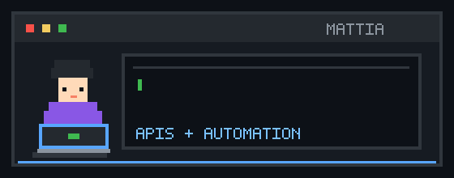

  

<h1 align="center">Hi 👋, I'm Mattia Di Donato</h1>

Full-stack developer based in Italy

  <a href="https://twitter.com/mattiadidonato5">Twitter</a> ·
  <a href="https://linkedin.com/in/mattia-di-donato-b341b1164">LinkedIn</a> ·
  <a href="https://instagram.com/mattiadidonato">Instagram</a> ·
  <a href="https://leetcode.com/mattiadido95">LeetCode</a>

## About me

I work across frontend and backend development, databases, APIs, and automation. I enjoy exploring different technologies and approaches to software design.

## AI & agents

I explore AI-assisted software development and reusable agent workflows for planning and coordinating complex tasks. My experiments include [orchestra-sviluppo](https://github.com/mattiadido95/orchestra-sviluppo), a collection of skills for Codex and Claude Code, and [human-writing](https://github.com/mattiadido95/human-writing), skills for natural writing and style calibration.

## GitHub activity

  
  

  

## Languages and tools

### Frontend

|   |   |   |   |   |   |   |
| --- | --- | --- | --- | --- | --- | --- |
|  HTML |  CSS |  JavaScript |  TypeScript |  Angular |  React |  Bootstrap |

### Backend and APIs

|   |   |   |   |   |   |   |
| --- | --- | --- | --- | --- | --- | --- |
|  Node.js |  Express |  Python |  Java |  Go |  PHP |  GraphQL |

### Data

|   |   |   |   |   |   |
| --- | --- | --- | --- | --- | --- |
|  PostgreSQL |  MySQL |  MongoDB |  Cassandra |  pandas |  Hadoop |

### Tools and platforms

|   |   |   |   |   |
| --- | --- | --- | --- | --- |
|  Git |  Docker |  Linux |  Google Cloud |  Postman |

### Other technologies

|   |   |   |   |   |   |
| --- | --- | --- | --- | --- | --- |
|  C |  C++ |  Swift |  Arduino |  MATLAB |  Photoshop |
